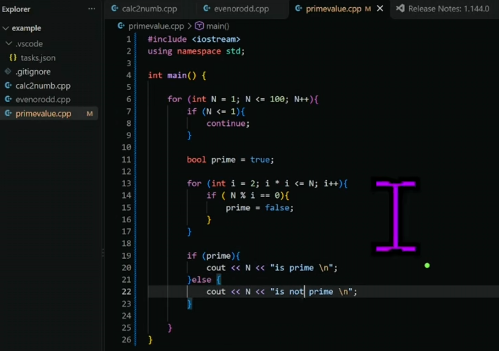
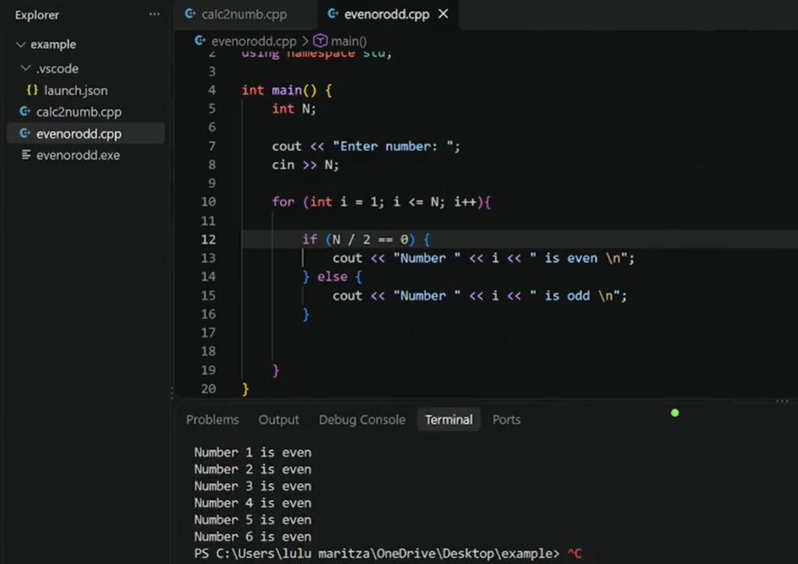
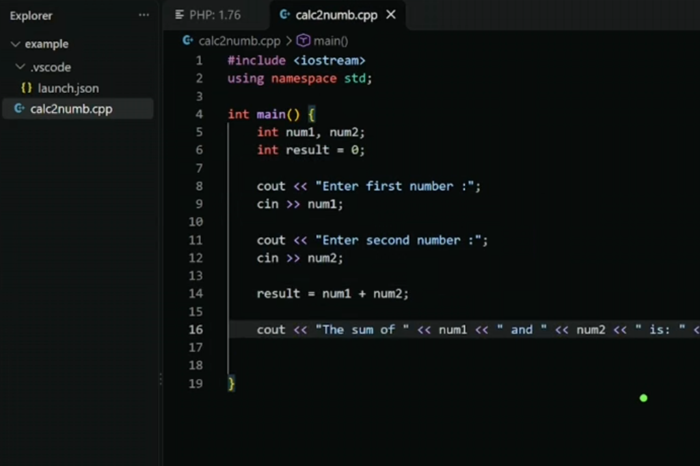

Hi, I'm Lulu Maritza Hikmah Panggabean!

A Software Engineer and a GameBuilder !! :3 
sharing about my journey and learnings in tech
Studied Software Engineering Technology at the Polithenic Negeri Medan, Indonesia~
Making videos about Computer Science, tech, and productivity on ma TikTok.
Currently learning about Programming, AI, and developing my game (alsooo working as a builder and a scripter on GARYIN in roblox) 

### Languages & Cor

### Tools & Software

<h2> Featured TikTok Videos</h2>

<table>
  <tr>
    <td align="center" width="33%">
      <a href="https://www.tiktok.com/@axmziia/video/7702558324587318534">
         
      </a>
    </td>
    <td align="center" width="33%">
      <a href="https://www.tiktok.com/@axmziia/video/7702000420142517512">
         
      </a>
    </td>
    <td align="center" width="33%">
      <a href="https://www.tiktok.com/@axmziia/video/7701555998036643124">
         
      </a>
    </td>
  </tr>
</table>

  
   
  

###

<picture data-importer="pacman">
  <source media="(prefers-color-scheme: dark)" srcset="https://raw.githubusercontent.com/axmziia/axmziia/pacman-output/pacman-contribution-graph-dark.svg?game=pacman">
  <source media="(prefers-color-scheme: light)" srcset="https://raw.githubusercontent.com/axmziia/axmziia/pacman-output/pacman-contribution-graph.svg?game=pacman">
  
</picture>

###

